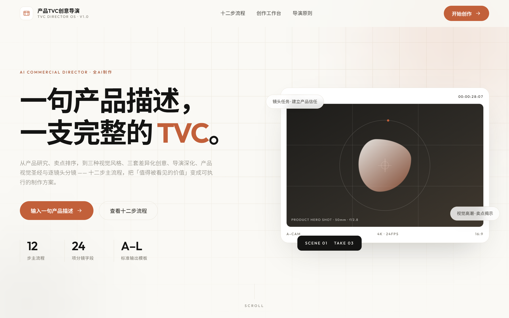
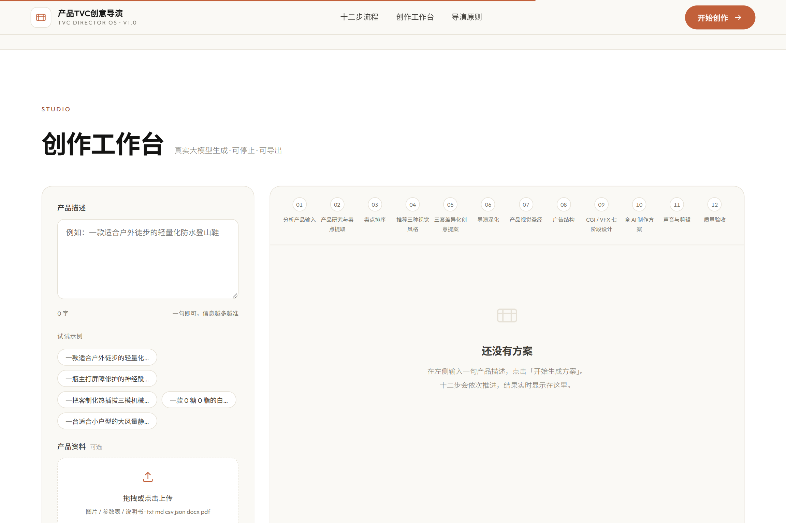
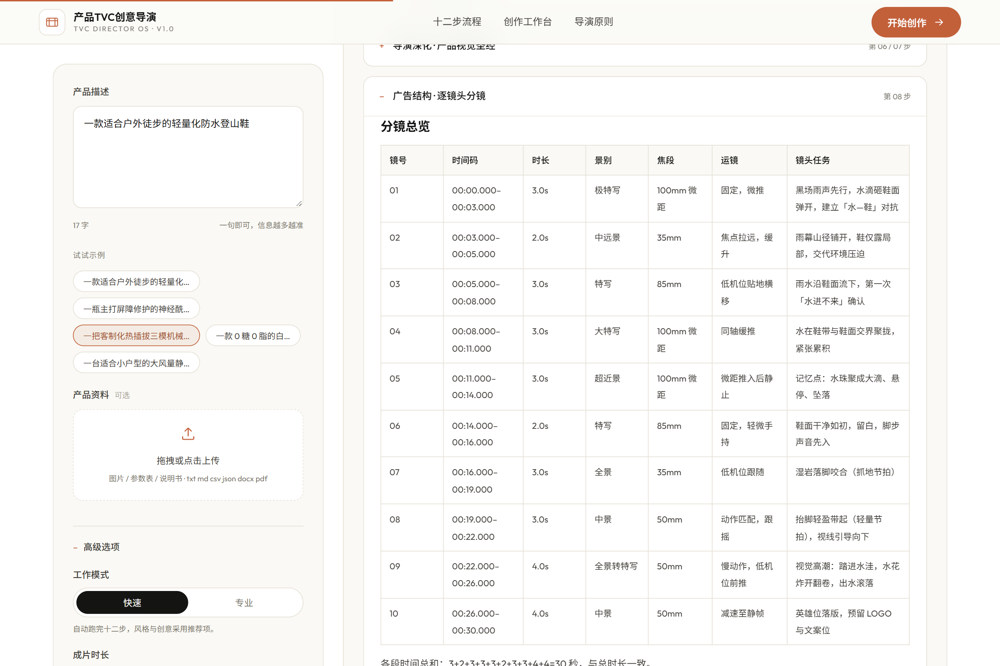

# 产品TVC创意导演 · Product TVC Director

**从一句产品描述，到一支完整 AI 商业 TVC 的创意、导演脚本与逐镜头制作方案。**

输入「一款适合户外徒步的轻量化防水登山鞋」这样一句话，浏览器里的十二步主流程会依次产出：项目简报 → 卖点研究报告 → 卖点排序 → 三种视觉风格 → 三套差异化创意 → 导演深化 → 产品视觉圣经 → 逐镜头分镜 → CGI/VFX 设计 → 全 AI 制作方案 → 声音与剪辑 → 质量验收，最后导出一份可直接交给制作团队的 Markdown 方案。

纯前端 · 无需构建 · 无需后端 · 支持任意 OpenAI 兼容模型



## 为什么做这个

用大模型写广告创意不难，难的是让它像一位真正的创意导演那样工作：先分清哪些是已确认事实、哪些只是合理推断；先把卖点排优先级再谈创意；先定视觉风格再谈分镜；每个镜头的焦段、运镜、时长都要有理由，而且时长总和必须等于成片时长。

这个项目把《产品TVC创意导演 Skill V1.0》里那套方法论固化成了流程：**十二步严格分段，每一步都有输出格式约束，不能在第一步就跳到镜头**。它不是「一句话生成一段文案」的玩具，而是一条可以交付的制片流水线。

## 十二步流程

| 步骤 | 做什么 | 关键产出 |
| --- | --- | --- |
| 01 | 分析产品输入 | 项目简报 + 只问 1~3 个会改变判断的关键问题 |
| 02 | 产品研究与卖点提取 | 八维研究 + 五层卖点模型（事实→功能→利益→情绪→表达） |
| 03 | 卖点排序 | 核心/辅助/差异化/情绪四类，五维各评 1~5 分 + 卖点到镜头转换表 |
| 04 | 推荐三种视觉风格 | 风格关键词、色彩体系、光影、摄影语言、AI 制作难点（**等待选择**） |
| 05 | 三套差异化创意提案 | 每套 17 个必备字段、1 主 2 备选开头、产品露出策略、100 分制评分 |
| 06 | 导演深化 | 故事是否成立、产品为何进入故事、视觉高潮在哪等 10 问（**等待确认**） |
| 07 | 产品视觉圣经 | 五视角外观、结构比例、材质、Logo 位置、左右件关系、禁改区域 |
| 08 | 广告结构 + 逐镜头分镜 | 每镜 24+ 字段：时间码/景别/焦段及理由/运镜/构图/光影/提示词/风险 |
| 09 | CGI/VFX 七阶段 | 初始→凝聚→核心形态→运动变化→作用互动→范围强度→结束方式 |
| 10 | 全 AI 制作方案 | 按镜头任务匹配 AI 图像/视频/合成/三维，关键帧工作流与连续性检查 |
| 11 | 声音与剪辑 | 逐镜音乐、环境音、动作音效、旁白、留白与声画同步 |
| 12 | 质量验收 | 先过 9 条一票否决项，再按产品类型加权评分 |

第 04、06 步在**专业模式**下会暂停等你选择，**快速模式**则采用模型推荐项自动跑完。



## 快速开始

```bash
git clone https://github.com/<你的账号>/product-tvc-director.git
cd product-tvc-director
cp config.example.js config.js   # 填入你的模型接口
python -m http.server 5173 --bind 127.0.0.1
```

打开 <http://127.0.0.1:5173/>。**必须通过 HTTP 访问**，直接双击 `index.html` 会因跨域与 CDN 限制导致调用失败。

### 三种接入方式

`config.js` 里有三选一的配置（该文件已被 `.gitignore` 忽略，不会上传）：

**A. WorkBuddy 云服务（免密钥）** — 在 WorkBuddy 中为本项目开通云服务，把返回的 `endpoint` / `publishableKey` / `oauthRelayBaseUrl` 填进去。前端只持有 publishableKey，它本身不带权限，服务端按 Origin 校验。

**B. OpenAI 兼容接口（自带 Key）** — 任何支持 `stream: true` 的服务都能用：

```js
window.TVC_CONFIG = {
  provider: "openai",
  baseUrl: "https://api.openai.com/v1",
  apiKey: "sk-...",
  models: ["gpt-4o-mini", "gpt-4o"],
};
```

**C. 本地模型** — Ollama / vLLM / LM Studio 大多兼容 OpenAI 协议：

```js
window.TVC_CONFIG = {
  provider: "openai",
  baseUrl: "http://127.0.0.1:11434/v1",
  apiKey: "ollama",
  models: ["qwen2.5:14b"],
};
```

> Key 写在浏览器里只适合本地或个人使用。要公开部署给他人用，请在前面加一层服务端代理，把 Key 留在服务端。

## 功能

- **流式生成**：十二步按 9 个模型阶段推进，边生成边渲染，Markdown 表格实时成型
- **阶段间自动传递上下文**：前一步的简报、卖点、选定风格都会注入后续提示词
- **快速 / 专业双模式**：专业模式在关键决策点暂停，由人拍板
- **停止与断点重试**：随时中断；某一阶段失败可「从本阶段重试」，已生成内容不丢
- **资料上传**：产品图片（本地预览）、参数表与说明书（txt / md / csv / json / docx / pdf）
- **导出 Markdown**：带 BOM，Excel 与记事本打开不乱码；也可一键复制全文
- **零依赖安装**：CDN 加载 SDK、marked、DOMPurify、GSAP，docx/pdf 解析组件按需动态加载
- **移动端可用**：窄屏自动转纵向，无横向溢出



上面是真实生成的第 08 步：每镜都有镜号、时间码、时长、景别、焦段、运镜与镜头任务，底部还带着「各段时间总和 3+2+3+3+2+3+3+3+4+4=30 秒，与总时长一致」的校验。

一份真实生成的完整方案见 [`docs/示例方案_白桃气泡水.md`](docs/示例方案_白桃气泡水.md)（约 3.8 万字，含 25 张表格、镜号与时间码）。

## 项目结构

```
product-tvc-director/
├── index.html            页面结构、CDN 引入
├── styles.css            设计系统：米白编辑风 + 单一琥珀强调色 + 视差层次
├── config.example.js     配置模板（复制为 config.js）
├── js/
│   ├── cloud.js          模型接入层：WorkBuddy 云服务 / OpenAI 兼容，SSE 流式解析
│   ├── prompts.js        系统提示词与 9 个阶段任务模板（方法论都在这里）
│   ├── pipeline.js       阶段编排、风格/创意解析、自动选择、导出
│   ├── markdown.js       marked + DOMPurify 安全渲染
│   ├── data.js           十二步 / 示例 / 原则 / 输出模板文案
│   ├── app.js            工作台交互、文件解析、流式渲染、草稿
│   └── motion.js         Hero 双层视差、GSAP 横向流程、滚动进度
└── docs/
    ├── screenshots/
    └── 示例方案_白桃气泡水.md
```

## 实现上的几个取舍

**为什么不分步请求而是分阶段。** 十二步合并为 9 个模型调用：相邻且强依赖的步骤（如导演深化 + 视觉圣经）放在一次调用里，减少上下文断裂；而风格选择、创意选择这类需要人拍板的环节独立成阶段，才能暂停。

**风格与创意怎么变成可点的卡片。** 提示词强制模型用 `## 风格一｜名称` 这样的二级标题分段，前端用正则解析成卡片。格式约定比 JSON 更稳，模型偶尔漏字段也不会整段解析失败。

**为什么禁止在上下文里塞图片。** 产品外观一致性由「产品视觉圣经」用文字锁死（五视角、比例、Logo 朝向、禁改区域），像素图只在本地给人看。多模态读图会让不同模型的结论漂移，反而破坏一致性。

**时长守恒。** 分镜提示词要求所有镜头时长之和严格等于成片总时长，导出时可直接用作排期依据。

## 已知限制

- 长文阶段耗时较长，一支完整方案通常需要 3~6 分钟，取决于模型速度
- 产品图片不进入模型，涉及外观细节时方案会标注「待产品图确认」
- 分镜的精修仍需人：模型给的是可信的初稿，不是终稿
- 模型输出质量随所选模型波动较大，建议用较强模型跑 04~08 步

## Roadmap

- [ ] 分镜表导出为 CSV / 飞书多维表格，便于排期
- [ ] 逐镜 AI 图像提示词批量导出为 Midjourney / 即梦格式
- [ ] 项目本地存档与多方案对比
- [ ] 英文界面

## 授权

[MIT](LICENSE)。方法论来自《产品TVC创意导演 Skill V1.0》，欢迎提 issue 交流流程设计。
